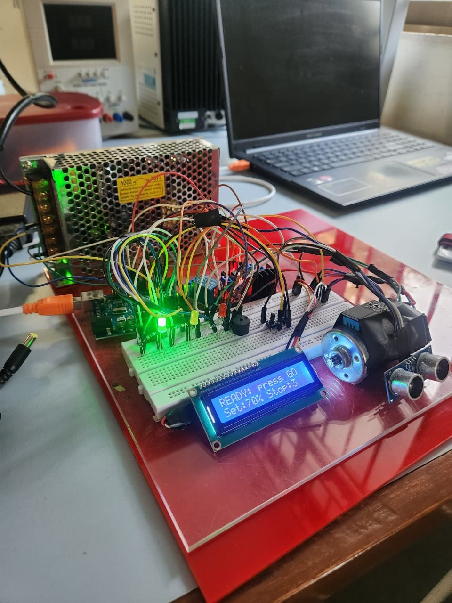
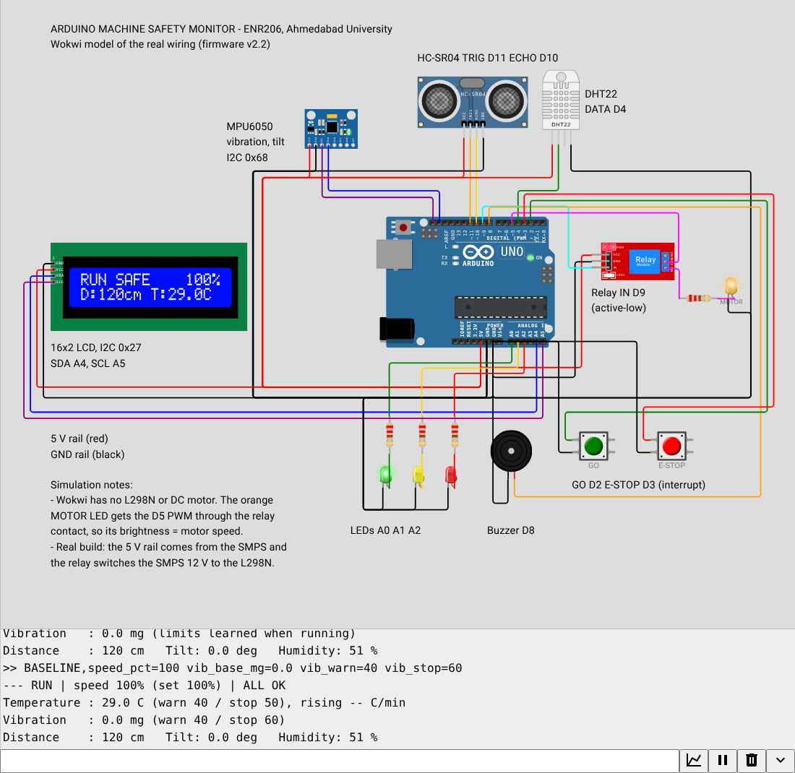
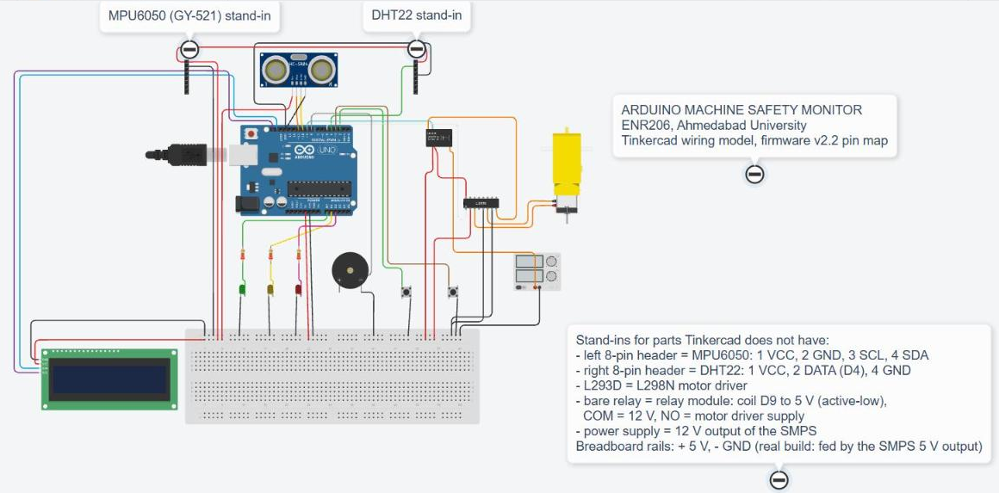
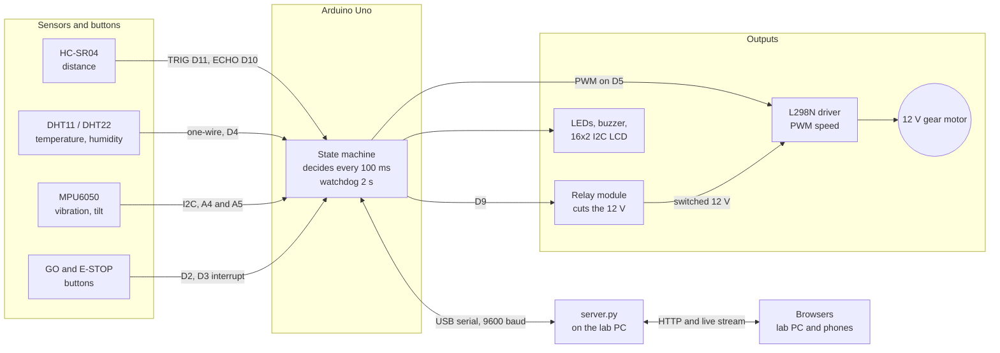
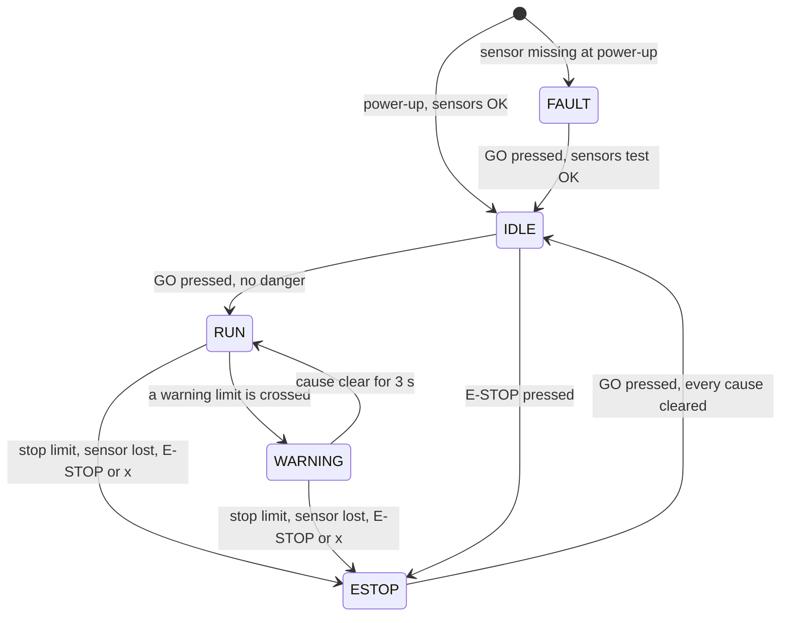
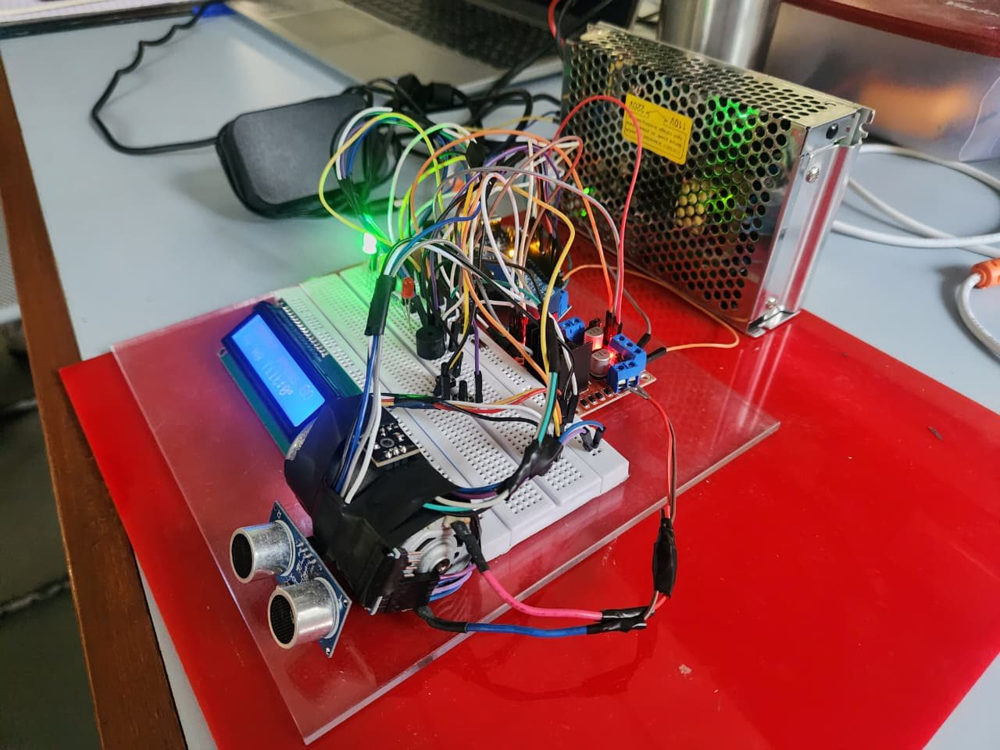
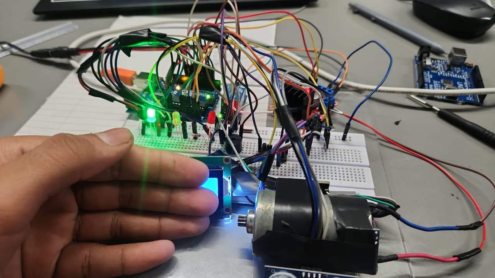
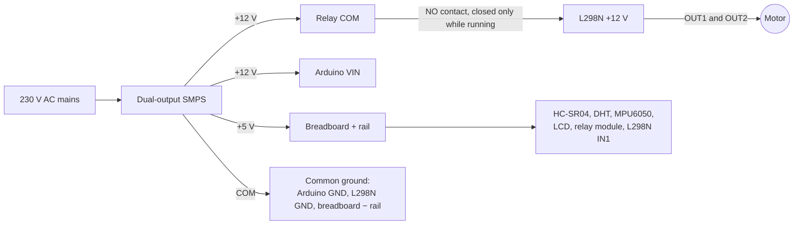

# Arduino Machine Safety Monitor

**An open-source safety controller for small machines, built on an Arduino Uno.** It watches a running 12 V motor
for a person coming too close, overheating, abnormal vibration, a tilted machine and a jammed shaft. It slows the
motor when something looks wrong, cuts the power when it is dangerous, and keeps it off until a person resets it.
A live web dashboard runs the machine from the lab PC and lets anyone on the same Wi-Fi watch it, and stop it, from
a phone.

[](https://github.com/DhairyaSanathara/Arduino-Machine-Safety-Monitor/actions/workflows/ci.yml)
[](LICENSE)


[](labs/)
[](CONTRIBUTING.md)

<p align="center">
  
  &nbsp;
  
</p>

Built by **Dhairya Sanathara, Kaushal Chitlange, Mahi Mistry and Kavan Vyas** for ENR206 at Ahmedabad University
(Monsoon 2026), guided by **Prof. Aditya Tiwari**. Released under the MIT License so anyone can build it, learn
from it and improve it.

> [!WARNING]
> This is a teaching prototype, not a certified safety system. Read [SAFETY.md](SAFETY.md) before building one.

---

## Contents

- [What it protects against](#what-it-protects-against)
- [Highlights](#highlights)
- [Try it in two minutes, no hardware](#try-it-in-two-minutes-no-hardware)
- [Demo video and circuit simulations](#demo-video-and-circuit-simulations)
- [System architecture](#system-architecture)
- [Firmware design](#firmware-design)
- [How the controller decides](#how-the-controller-decides)
- [Hardware](#hardware)
- [Build your own](#build-your-own)
- [Commands](#commands)
- [Web dashboard](#web-dashboard)
- [Testing](#testing)
- [Repository layout](#repository-layout)
- [Contributing and labs](#contributing-and-labs)
- [Documentation](#documentation)
- [Limitations and roadmap](#limitations-and-roadmap)
- [Team, citation and license](#team-citation-and-license)

---

## What it protects against

| Hazard | Sensor | Warning (motor slows to 45 %) | Emergency stop (power cut, latched) |
| --- | --- | --- | --- |
| Person too close | HC-SR04 ultrasonic | Closer than 40 cm | Closer than 15 cm |
| Overheating | DHT11 / DHT22 | 40 °C | 50 °C |
| Temperature rising fast | DHT, slope over the last ~30 s | 6 °C per minute | 15 °C per minute |
| Abnormal vibration | MPU6050 | 2 × the learned normal level | 3.5 × the learned normal level (always above 800 mg) |
| Machine tilted or knocked over | MPU6050 | 10° from its installed position | 25° |
| Motor stalled or jammed | MPU6050 (vibration collapses at steady speed) | | Below 35 % of normal for 1.5 s |
| Sensor missing or lost | Self-test at power-up, checks while running | | FAULT at power-up; emergency stop while running |
| Operator command | E-STOP button, website, any phone | | Immediate |

## Highlights

- **Learned vibration limits.** The first time the motor runs at a speed, the controller measures the healthy
  machine for 4 s and sets that speed's limits as multiples of it. Each 10 % speed step has its own baseline.
- **Temperature by level and by rate.** A least-squares line through the last 15 readings gives °C/min, so a
  fast-heating fault is caught before the absolute limit.
- **Stall detection without a current sensor.** A turning motor always vibrates; a collapse in vibration at a
  steady speed means the shaft has stopped.
- **Layered fail-safe design.** Energise-to-run relay, emergency stop on a hardware interrupt, 2 s watchdog,
  latching stop with a first-out reason, no auto-start, and sensors checked at power-up and while running.
- **Two independent ways to cut the motor.** The L298N stops driving it and the relay physically opens its 12 V
  supply.
- **Non-blocking firmware.** A `millis()` scheduler runs the safety decision every 100 ms and samples vibration at
  100 Hz; nothing waits in `delay()`.
- **Tested without hardware.** The real firmware runs on a PC against a simulated machine in 17 safety tests, on
  every push.
- **Live web HMI.** A Python server bridges USB serial to every browser: state banner, seven live values, three
  trend graphs, protection checks, session counters, event log and CSV logging. Only the lab PC can start the
  machine; any viewer can stop it.

## Try it in two minutes, no hardware

```bash
git clone https://github.com/DhairyaSanathara/Arduino-Machine-Safety-Monitor.git
cd Arduino-Machine-Safety-Monitor
python3 -m pip install -r web/requirements.txt pytest

make demo   # dashboard with a simulated machine at http://localhost:8000
make test   # the firmware's safety tests and the web server tests
```

`make demo` runs a pretend machine that sends exactly the same data as the Arduino, so you can press Start, change
the speed and trigger an emergency stop from the browser. `make test` compiles the real firmware for your PC and
drives it through 17 scenarios: a person walking up, a jammed shaft, a sensor unplugged mid-run, and more. On
Windows, run `make` inside WSL, or double-click `web/start_demo.bat` for the demo alone.

## Demo video and circuit simulations

| | |
| --- | --- |
| **Project report** | [Word (.docx)](docs/report/ENR206_Project_Report_Arduino_Machine_Safety_Monitor.docx) or [PDF](docs/report/ENR206_Project_Report_Arduino_Machine_Safety_Monitor.pdf): the full ENR206 report with theory, circuits, code and results |
| **Demo video** | [docs/video/demo.mp4](docs/video/demo.mp4) (4 min): start-up, speed steps on the dashboard, a hand in the warning zone, the E-STOP button and the session summary |
| **Wokwi** (runs the real firmware in the browser) | [wokwi.com/projects/480655257715515393](https://wokwi.com/projects/480655257715515393), files in [hardware/wokwi](hardware/wokwi) |
| **Tinkercad** (breadboard wiring with a wiring-check sketch) | [hardware/tinkercad](hardware/tinkercad): screenshots, full connection list and the sketch |

| Wokwi: firmware v2.2 running | Tinkercad: breadboard model |
| --- | --- |
|  |  |

## System architecture



The PC only exchanges data over USB. Every safety decision is made on the Arduino, so the machine stays safe if
the PC crashes or the cable is pulled.

## Firmware design

The firmware is a standard Arduino sketch split into one module per job, so you can find any behaviour in one
place. Settings live in `config.h`; everything else is in `src/`.

```
firmware/MachineSafetyMonitor/
├── MachineSafetyMonitor.ino   setup() and loop(): the scheduler, plus an overview of the whole design
├── config.h                   pins, hardware options, limits, timing: the file to edit for your build
└── src/
    ├── app.h                  shared types, states, stop reasons, globals and every function's prototype
    ├── state.cpp              all global variables and their start values
    ├── safety.cpp             evaluate() and the state machine: IDLE, RUN, WARNING, ESTOP, FAULT
    ├── sensors.cpp            ultrasonic, temperature trend, vibration RMS, tilt, learned baselines
    ├── motor.cpp              soft start, PWM, relay, and the E-STOP interrupt
    ├── self_test.cpp          power-up checks
    ├── mpu6050.cpp            MPU6050 read straight from its registers (no library)
    ├── dht_sensor.cpp         DHT11 / DHT22 auto-detection
    ├── i2c_bus.cpp            I2C with time-outs, so a jammed bus cannot freeze the loop
    ├── ina219.cpp             optional current sensor (compiled out by default)
    ├── lcd.cpp                self-healing 16×2 LCD driver, a few characters per pass
    ├── indicators.cpp         LEDs, buzzer patterns, lamp test
    ├── commands.cpp           buttons with debounce, serial commands, speed set point
    ├── reports.cpp            readable status reports and Serial Plotter output
    ├── datalog.cpp            CSV rows for the dashboard, sent without blocking
    ├── strings.cpp            state names and stop reasons, kept in flash
    └── util.cpp               small maths and formatting helpers
```

Every pass of `loop()` feeds the watchdog, reads the buttons, then runs each task when its time is due: vibration
sampling at 100 Hz, the safety decision every 100 ms, distance every 70 ms, temperature every 2 s, and display and
logging work in small slices. The Uno build uses **31,798 of 32,256 bytes of flash and 1,299 of 2,048 bytes of
RAM**. The scheduler, state machine and every safety layer are explained in [docs/firmware.md](docs/firmware.md).

## How the controller decides



| State | Motor | Lights and sound |
| --- | --- | --- |
| IDLE | Off, relay open, ready | Green blinking (yellow too if a danger is present) |
| RUN | At the set speed | Green; fast blink while learning the vibration baseline |
| WARNING | Slowed to 45 % | Yellow, a short beep every second |
| ESTOP | Off, relay open, **latched** | Red flashing with alarm while the danger is present; steady red with a chirp every 2 s once GO can reset it |
| FAULT | Off; a sensor was missing at power-up | Red and yellow alternating, a chirp every 3 s |

**Safety layers**

1. The relay is energise-to-run: no power, a reset or a broken wire means no motor.
2. The E-STOP button is on a hardware interrupt, so the motor is cut within microseconds.
3. A 2 s watchdog restarts a frozen program, which drops the relay (layer 1).
4. Stops are latched with a first-out reason and never restart by themselves.
5. No auto-start at power-up; GO is refused while a danger is present.
6. Sensors are checked at start-up and continuously; an I2C bus jam cannot freeze the loop (25 ms time-out).

## Hardware

<p align="center">
  
  
</p>

| Component | Qty | Role | Interface |
| --- | --- | --- | --- |
| Arduino Uno R3 (ATmega328P) | 1 | Controller | — |
| Dual-output SMPS, 230 V AC to 12 V and 5 V | 1 | Power for everything | — |
| 12 V DC geared motor | 1 | The "machine" | Driven by the L298N |
| L298N dual H-bridge module | 1 | Motor speed (PWM on ENA) | D5 (also mirrored on D6) through 10 kΩ |
| 5 V single-channel relay module (SRD-05VDC) | 1 | Hard power switch for the motor's 12 V | D9, active-low |
| HC-SR04 ultrasonic sensor | 1 | Distance to a person | TRIG D11, ECHO D10 |
| DHT22 or DHT11 | 1 | Air temperature and humidity at the motor | One-wire on D4 |
| MPU6050 (GY-521) | 1 | Vibration RMS and tilt | I2C (0x68) |
| 16×2 LCD with PCF8574 I2C backpack | 1 | Local status display | I2C (0x27 or 0x3F) |
| Push buttons | 2 | GO (start / reset), E-STOP | D2, D3 (interrupt) |
| LEDs: green, yellow, red, with 220 Ω | 3 | Safe, warning, stopped | A0, A1, A2 |
| Active buzzer | 1 | Warning beeps and stop alarm | D8 |
| 10 kΩ resistor, 100 nF capacitor | 1 each | ENA protection; motor noise suppression | — |

The full bill of materials with every connection is in [hardware/BOM.csv](hardware/BOM.csv), and
[hardware/README.md](hardware/README.md) has photos of the prototype and each build stage. Every part is explained
in [docs/components](docs/components): what it does, the physics behind it, and why it is wired the way it is.

### Wiring at a glance

| Arduino pin | Connected to | Signal |
| --- | --- | --- |
| D2 | GO button to GND | Digital in, internal pull-up |
| D3 | E-STOP button to GND | Digital in, external interrupt INT1 |
| D4 | DHT data | One-wire, timed pulses |
| D5 (and D6) | L298N ENA through 10 kΩ | PWM, about 977 Hz |
| D8 | Active buzzer + | Digital out |
| D9 | Relay module IN | Digital out, active-low |
| D10 | HC-SR04 ECHO | Pulse width = echo time |
| D11 | HC-SR04 TRIG | 10 µs pulse |
| A0, A1, A2 | Green, yellow, red LEDs through 220 Ω | Digital out |
| A4 (SDA), A5 (SCL) | MPU6050 and LCD backpack | I2C, 100 kHz |
| VIN | SMPS +12 V | Power in |
| GND | Common ground rail | 0 V reference |



L298N IN1 goes to +5 V and IN2 to GND, so the motor always turns one way; the Arduino controls only power (relay)
and speed (ENA). The full connection list, assembly order and checks are in [docs/wiring.md](docs/wiring.md).

## Build your own

### 1. Wire it

Follow [docs/wiring.md](docs/wiring.md) with the SMPS switched off. Check the common ground before power-up. New
to the parts? Bring them up one at a time with the small sketches in [firmware/bringup](firmware/bringup) (serial,
power, LCD, DHT, MPU6050, PWM pins, motor speed).

### 2. Upload the firmware

1. Install the Arduino IDE (or `arduino-cli`).
2. *Tools → Manage Libraries*, install:
   - **LiquidCrystal I2C** by Frank de Brabander
   - **DHT sensor library** by Adafruit (accept **Adafruit Unified Sensor**)
3. Open `firmware/MachineSafetyMonitor/MachineSafetyMonitor.ino`. The IDE opens `config.h` and the `src/` files
   with it.
4. Check `config.h`: the relay pin and polarity, and `ENA_PIN` if your board has a damaged PWM pin.
5. Choose *Arduino Uno*, upload, and open the Serial Monitor at **9600 baud**: a readable report appears every 2 s.

With `arduino-cli`:

```bash
arduino-cli lib install "LiquidCrystal I2C" "DHT sensor library" "Adafruit Unified Sensor"
arduino-cli compile --fqbn arduino:avr:uno firmware/MachineSafetyMonitor
arduino-cli upload  --fqbn arduino:avr:uno -p /dev/ttyACM0 firmware/MachineSafetyMonitor
```

### 3. Start the dashboard

```bash
python3 -m pip install -r web/requirements.txt
python3 web/server.py              # finds the Arduino by itself
python3 web/server.py --port COM11 # or name the port
```

On Windows, double-click `web/start_monitor.bat`. The browser opens at **http://localhost:8000**. Phones on the same
Wi-Fi can open the address printed in the server window. Close the Arduino IDE's Serial Monitor first: only one
program can use the port.

## Commands

Type these in the Serial Monitor (9600 baud, any line ending) or the website's command box.

| Command | Action |
| --- | --- |
| `g` | GO: start, or reset after a stop |
| `x` | Emergency stop |
| `10` … `100` + Enter | Speed set point in %, steps of 10 |
| `+` / `-` | Speed ±10 % |
| `s` | Status report in plain words |
| `z` | Re-zero tilt (current position = level) |
| `l` | Forget the learned vibration baselines and learn again |
| `n` | Readable text report every 2 s (default) |
| `d` | CSV data for the dashboard, every 0.5 s |
| `v` / `t` / `b` | Serial Plotter graphs: vibration / temperature / both |
| `?` | Help |

The data format is documented in [docs/serial-protocol.md](docs/serial-protocol.md).

## Web dashboard

| Day mode | Emergency stop | Phone |
| --- | --- | --- |
|  |  |  |

- Machine state banner with Start/Reset, speed set point and a large emergency-stop button (also the **Esc** key).
- Seven live tiles: speed, estimated shaft RPM, temperature and rise rate, vibration, nearest person, tilt,
  humidity, each with its warning and stop zones.
- Three live graphs (1, 2 or 5 minutes) with the learned and fixed limits drawn in.
- Protection checks, session counters (starts, stops, warnings, running time, peaks), system health and an event
  log.
- Every reading saved to `web/data/session_<date>.csv`; raw serial lines and a command box.
- Only the lab PC (`localhost`) can start the machine or change speed; any viewer can press emergency stop.

Details: [web/README.md](web/README.md).

## Testing

| Suite | What it checks | Run it |
| --- | --- | --- |
| Firmware safety tests | The real firmware, compiled for a PC, driven by a simulated machine: start-up, soft start, learned baselines, warning and stop zones, E-STOP interrupt, vibration trip, stall, tilt, fast heating, sensor loss, commands, data format (17 tests) | `make test-firmware` |
| Web server tests | Command whitelist, remote viewers limited to stop, history replay order, peaks and counters, demo machine, file serving (16 tests) | `make test-web` |
| Uno compile check | The sketch and every bring-up sketch compile for the Arduino Uno | CI |
| Bring-up sketches | Each part on the real hardware, one at a time | [firmware/bringup](firmware/bringup) |

The simulator in `tests/firmware/` models the world around the Arduino: the distance to a person, air temperature,
the motor's vibration as a function of its speed, tilt and a jammed shaft, plus the I2C devices and the LCD. A test
reads like a scenario:

```cpp
TEST(person_in_stop_zone_latches_an_emergency_stop) {
  startMotor();                    // power up, press GO, learn the vibration baseline
  world.distCm = 10;               // a hand inside the 15 cm stop zone
  run(1);
  CHECK(state == ST_ESTOP);
  CHECK(latchedReason == R_PROX);
  CHECK(!relayClosed());           // the motor's 12 V is cut
  CHECK(motorPwm() == 0);
  pressGo();
  run(0.5);
  CHECK(state == ST_ESTOP);        // refused: the person is still there
  world.distCm = 120;
  run(2);
  CHECK(state == ST_ESTOP);        // latched: never resets by itself
  ...
}
```

GitHub Actions runs all of this on every push and pull request. How we tested the real machine, and the problems we
solved on the way, is in [docs/testing.md](docs/testing.md).

## Repository layout

```
.
├── firmware/
│   ├── MachineSafetyMonitor/     the main program for the Arduino Uno (config.h + src/ modules)
│   └── bringup/                  one small sketch per part, for bring-up and debugging
├── web/
│   ├── server.py                 USB serial to web bridge, live stream, logging, demo machine
│   ├── index.html                the dashboard (single page, no build step)
│   └── start_monitor.bat, start_demo.bat
├── tests/
│   ├── firmware/                 PC simulator, Arduino library stand-ins, safety tests
│   └── web/                      web server tests (pytest)
├── hardware/                     bill of materials, prototype photos, Wokwi and Tinkercad models
├── docs/                         how every part, the firmware and the protocol work; report/ and video/
├── labs/                         open challenges for contributors
├── .github/                      CI workflow, issue and pull request templates
├── CONTRIBUTING.md  ROADMAP.md  CHANGELOG.md  SAFETY.md  SECURITY.md  CODE_OF_CONDUCT.md
└── Makefile                      make test, make demo
```

## Contributing and labs

Contributions of every size are welcome: a clearer sentence in the docs, a new test, a new sensor. Start with
[CONTRIBUTING.md](CONTRIBUTING.md) for the set-up and the rules (the main one: never make stopping weaker).

The [labs](labs/) are real improvements this project needs, each written up with the files to open, the steps and
a definition of done:

| Lab | What you build | Level |
| --- | --- | --- |
| [1. Detect a dead ultrasonic sensor](labs/01-detect-a-dead-ultrasonic-sensor/) | Turn today's fail-to-danger mode into a fault: an unplugged HC-SR04 must stop the machine | Good first issue |
| [2. Measure real RPM](labs/02-measure-real-rpm/) | An IR or Hall sensor on a pin-change interrupt, a new data column and a measured-vs-estimated graph | Intermediate |
| [3. Vibration spectrum (FFT)](labs/03-vibration-spectrum-fft/) | 1 kHz capture through the MPU6050 FIFO, an FFT on the PC, vibration velocity in mm/s | Advanced |

Found a bug? [Open an issue](../../issues/new/choose). Please follow the [code of conduct](CODE_OF_CONDUCT.md).

## Documentation

| Topic | File |
| --- | --- |
| Arduino Uno | [docs/components/arduino-uno.md](docs/components/arduino-uno.md) |
| SMPS and power distribution | [docs/components/smps-power-supply.md](docs/components/smps-power-supply.md) |
| Relay module | [docs/components/relay-module.md](docs/components/relay-module.md) |
| L298N motor driver and PWM | [docs/components/l298n-motor-driver.md](docs/components/l298n-motor-driver.md) |
| 12 V DC gear motor | [docs/components/dc-gear-motor.md](docs/components/dc-gear-motor.md) |
| HC-SR04 ultrasonic sensor | [docs/components/hc-sr04-ultrasonic.md](docs/components/hc-sr04-ultrasonic.md) |
| DHT11 / DHT22 | [docs/components/dht11-dht22.md](docs/components/dht11-dht22.md) |
| MPU6050 | [docs/components/mpu6050.md](docs/components/mpu6050.md) |
| I2C bus and 16×2 LCD | [docs/components/i2c-bus-and-lcd.md](docs/components/i2c-bus-and-lcd.md) |
| Buttons, LEDs and buzzer | [docs/components/buttons-leds-buzzer.md](docs/components/buttons-leds-buzzer.md) |
| Wiring | [docs/wiring.md](docs/wiring.md) |
| Firmware design | [docs/firmware.md](docs/firmware.md) |
| Serial protocol | [docs/serial-protocol.md](docs/serial-protocol.md) |
| Calculations | [docs/calculations.md](docs/calculations.md) |
| Testing and troubleshooting | [docs/testing.md](docs/testing.md) |
| Limitations and future work | [docs/limitations-and-future-work.md](docs/limitations-and-future-work.md) |

## Limitations and roadmap

This is a teaching prototype, not a certified safety system. The Arduino is not safety-rated, the E-STOP is a
normally open push button read by the microcontroller, an unplugged ultrasonic sensor reads "zone clear", RPM is
estimated from PWM rather than measured, and the DHT measures the air next to the motor rather than its windings.
[SAFETY.md](SAFETY.md) explains what that means for anyone building one, and
[docs/limitations-and-future-work.md](docs/limitations-and-future-work.md) has the full list. What comes next is on
the [roadmap](ROADMAP.md).

## Team, citation and license

| | |
| --- | --- |
| Course | ENR206, School of Engineering and Applied Science, Ahmedabad University, Monsoon 2026 |
| Guide | Prof. Aditya Tiwari |
| Team | Dhairya Sanathara, Kaushal Chitlange, Mahi Mistry, Kavan Vyas |

If you use this project in a report or paper, please cite it: GitHub shows a "Cite this repository" button generated
from [CITATION.cff](CITATION.cff).

Released under the [MIT License](LICENSE). Changes are listed in the [changelog](CHANGELOG.md).
