# Hardware

The prototype is built on an acrylic base plate: an Arduino Uno and a breadboard in the middle, a dual-output
SMPS behind, the 12 V geared motor at the front with the DHT22 strapped to its body, and the HC-SR04 facing out
from the front of the machine.

| File | What it is |
| --- | --- |
| [`BOM.csv`](BOM.csv) | Bill of materials: every part, its rating, what it does and where it connects |
| [`../docs/wiring.md`](../docs/wiring.md) | Full connection list, assembly order and checks before power-up |
| [`../docs/components/`](../docs/components) | How each part works and why it is wired this way |
| [`wokwi/`](wokwi) | Wokwi simulation that runs the real firmware ([open it](https://wokwi.com/projects/480655257715515393)) |
| [`tinkercad/`](tinkercad) | Tinkercad breadboard model: screenshots, connection list and a wiring-check sketch |

## The prototype

| | |
| --- | --- |
| 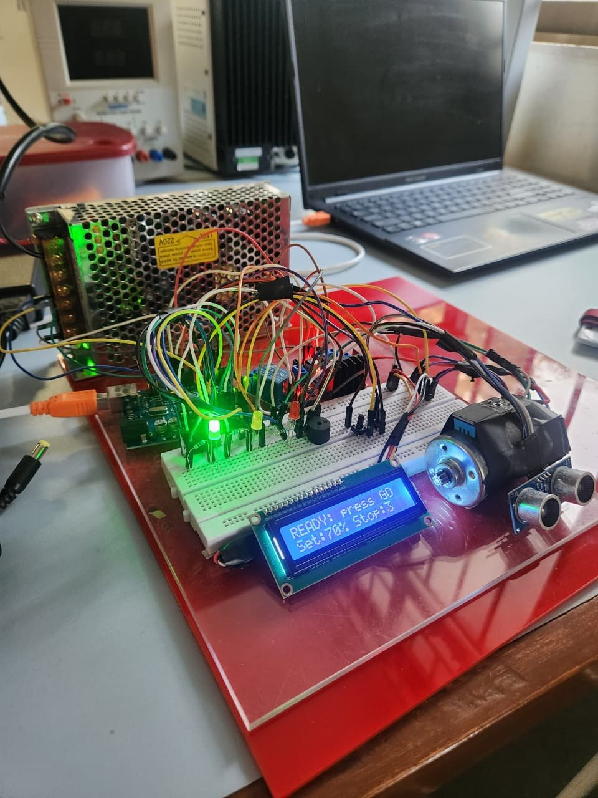 | 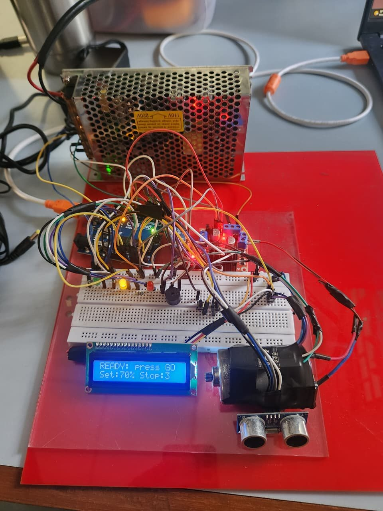 |
| Front view: LCD reads "READY: press GO", set speed 70 %, three stops so far | Overview: SMPS behind, Arduino and L298N in the middle, motor and HC-SR04 at the front |
| 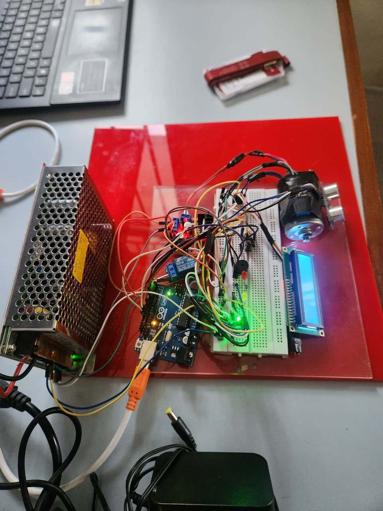 | 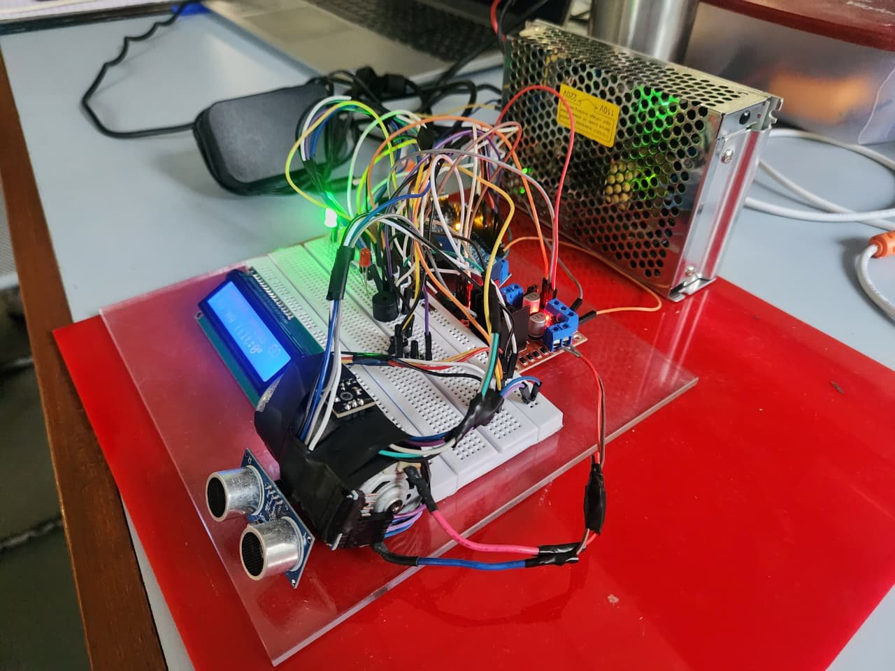 |
| Top view of the layout | Side view: L298N driver with heat sink next to the SMPS |

## The LCD pages

The second line of the LCD changes page every 2 s.

| | | |
| --- | --- | --- |
| 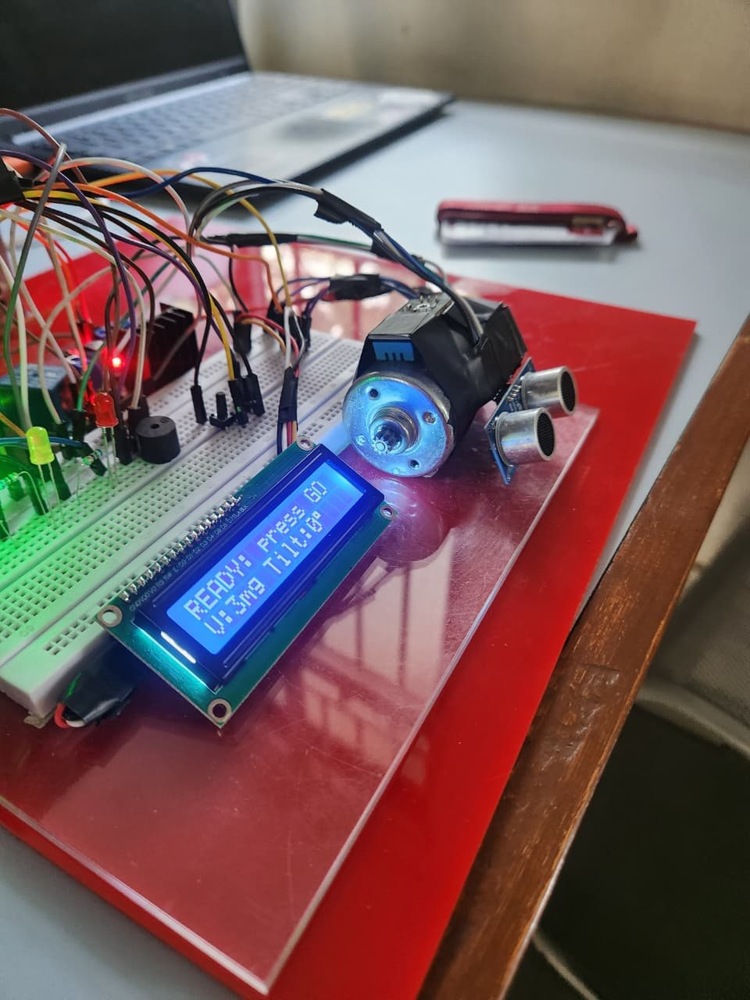 | 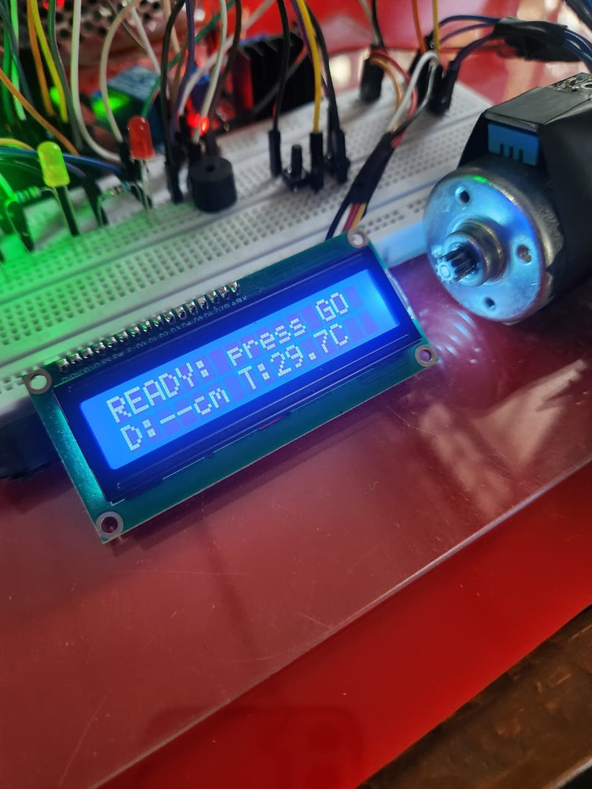 | 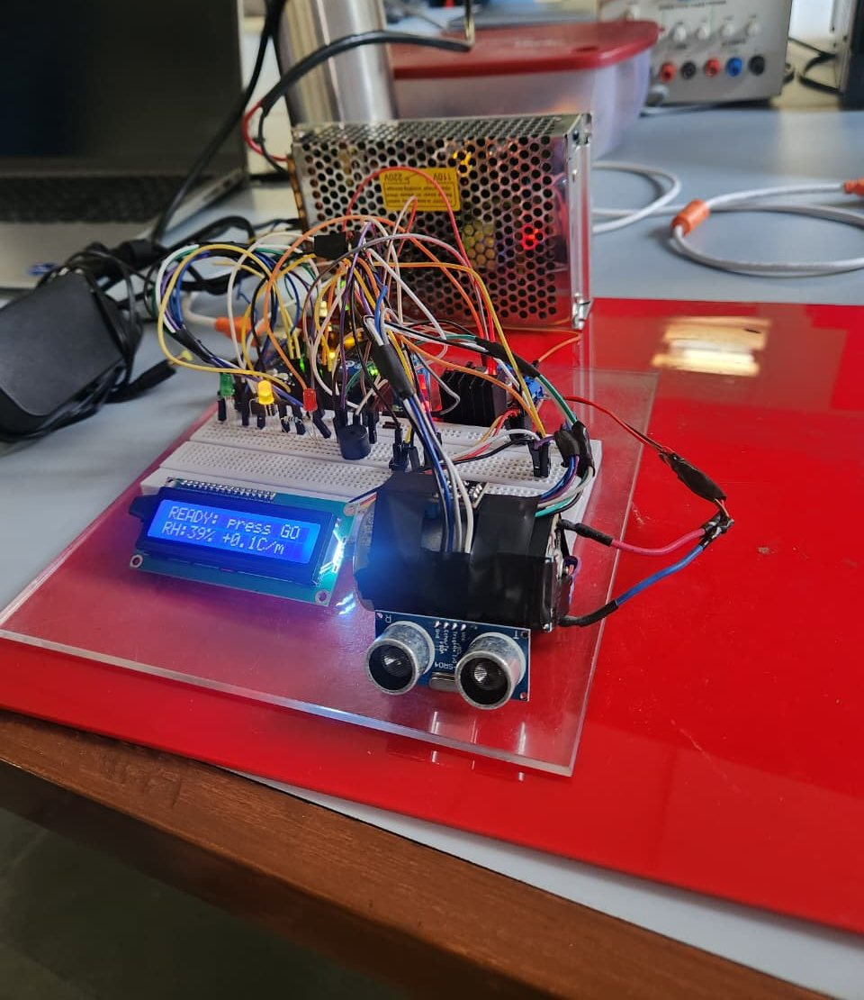 |
| Vibration 3 mg at rest, tilt 0° | Distance "--" (zone clear), temperature 29.7 °C; the DHT22 is on the motor | Humidity 39 %, temperature rising 0.1 °C/min |

## Building it

| | | |
| --- | --- | --- |
| 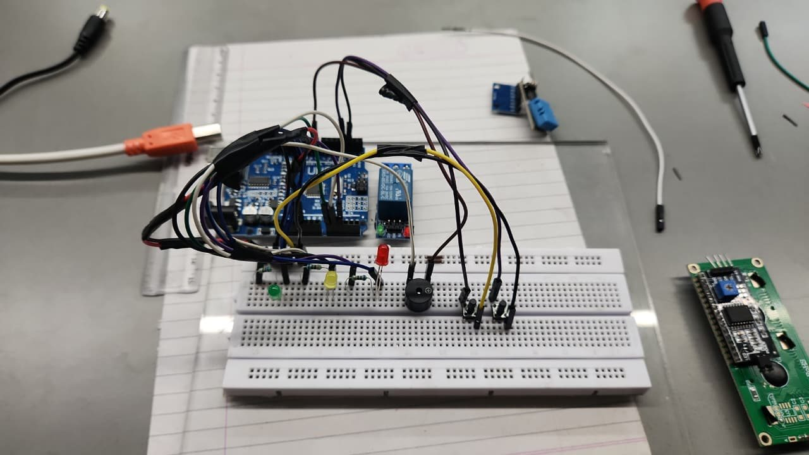 | 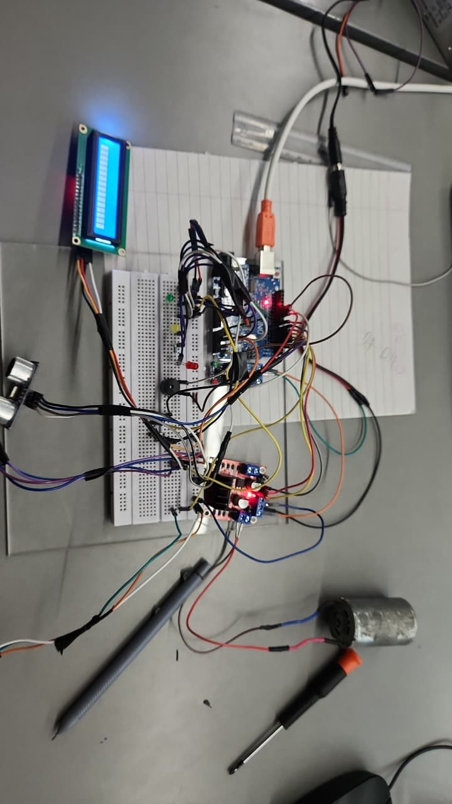 | 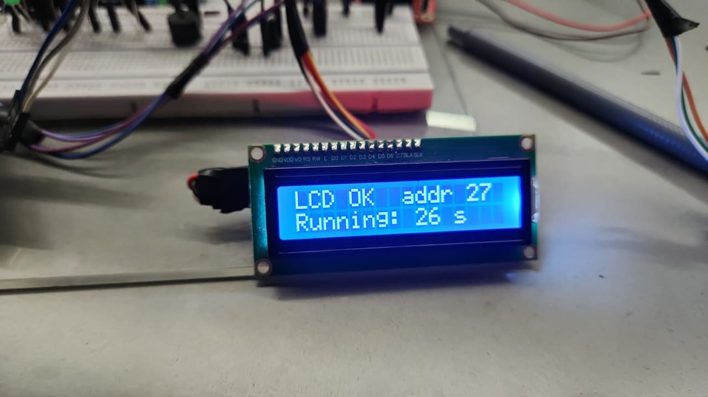 |
| First stage: Uno, relay, LEDs, buzzer and buttons on the breadboard | All modules wired, before the acrylic base | Bring-up: `lcd_test` found the LCD at address 0x27 |

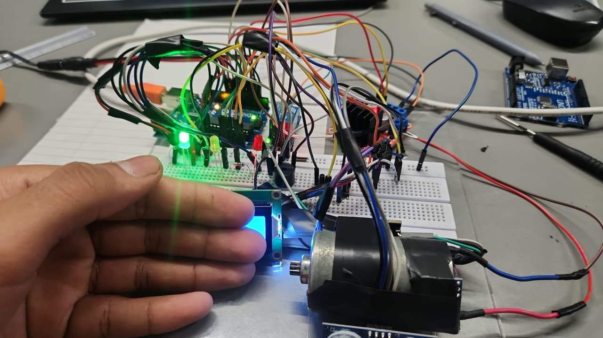

Testing the proximity check with a hand in front of the machine.

## Safety when you build one

- Wire everything with the SMPS unplugged. Mains terminals (L, N, earth) must be covered, and the metal case earthed.
- Never connect the 12 V output to any Arduino pin except VIN.
- This is a teaching prototype, not a certified safety system. Read [SAFETY.md](../SAFETY.md) before using it near
  anything that can hurt someone.
