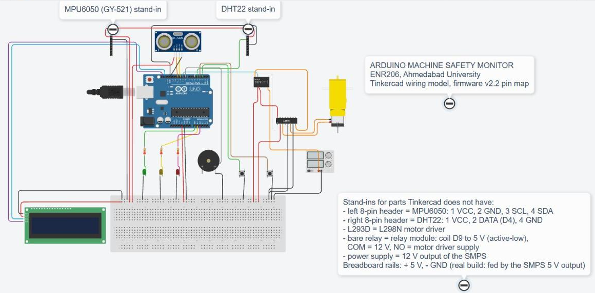
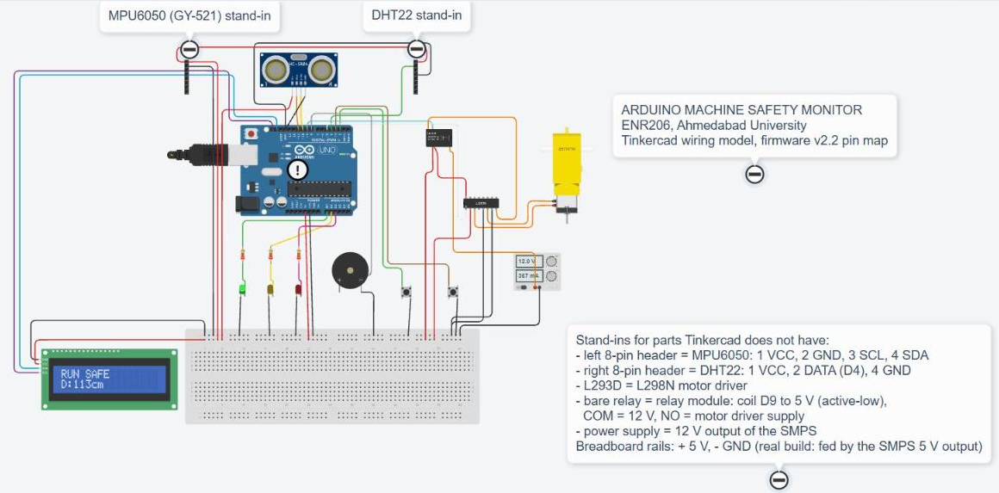

# Tinkercad model

A Tinkercad Circuits model of the machine: the same pins as the real build and firmware v2.2, laid out on a
breadboard with labelled parts, and a short wiring-check sketch that runs in Tinkercad's simulator.

**Design:** [Arduino Machine Safety Monitor (ENR206)](https://www.tinkercad.com/things/dbrLnCxSMj7) on Tinkercad.
Tinkercad designs are private until the owner shares them (Share, then Invite people or a public link).

*Breadboard view. The two notes explain the parts that Tinkercad does not have.*

*Simulation after pressing GO: the LCD reads "RUN SAFE, D:113cm", the green LED is on and the motor turns at about
290 RPM, drawing about 370 mA from the 12 V supply. The warning mark on the Uno is Tinkercad pointing out that D9
sinks about 29 mA for the bare relay coil (see the note under "Differences from the real build").*

## Files

| File | What it is |
| --- | --- |
| [`tinkercad_wiring_check.ino`](tinkercad_wiring_check.ino) | The sketch stored in the Tinkercad design. GO starts the motor, E-STOP stops it, the HC-SR04 warns under 40 cm and stops under 15 cm. Paste it into the Code panel (Text mode) of a copy of the design |

Tinkercad cannot export a circuit as a file that it can import again, so the design itself lives in Tinkercad. This
folder keeps the sketch, the screenshots and the full connection list below, which is enough to rebuild it.

## Parts that Tinkercad does not have

| Real part | Stand-in in Tinkercad | Pins used |
| --- | --- | --- |
| MPU6050 (GY-521) | 8-pin female header (left) | 1 VCC, 2 GND, 3 SCL, 4 SDA |
| DHT22 | 8-pin female header (right) | 1 VCC, 2 DATA to D4, 4 GND |
| L298N motor driver module | L293D driver chip | EN1 = D5 (PWM), IN1 = 5 V, IN2 = GND, Vs = 12 V through the relay, OUT1/OUT2 = motor |
| 5 V relay module (with its own transistor) | Bare SPDT relay | Coil between D9 and 5 V (active-low, like the module), COM = 12 V, NO = L293D Vs |
| Dual-output SMPS | Power supply set to 12 V | Its + goes to relay COM, its − to the GND rail |
| 12 V geared motor | Hobby gearmotor | L293D OUT1 / OUT2 |
| Active buzzer | Piezo | + to D8, − to GND |

## Connections

| From | To | Wire |
| --- | --- | --- |
| HC-SR04 TRIG, ECHO | D11, D10 | orange, yellow |
| HC-SR04 VCC | + rail | red |
| HC-SR04 GND | Uno GND (top header) | black |
| DHT22 header pin 2 (DATA) | D4 | green |
| DHT22 header pin 1 (VCC) | MPU6050 header pin 1 (5 V) | red |
| DHT22 header pin 4 (GND) | Uno GND (top header) | black |
| MPU6050 header pin 1 (VCC) | + rail | red |
| MPU6050 header pin 2 (GND) | − rail | black |
| MPU6050 header pins 3, 4 (SCL, SDA) | Uno SCL, SDA | purple, blue |
| LCD SCL, SDA | MPU6050 header pins 3, 4 (shared I2C bus) | purple, blue |
| LCD VCC, GND | + rail, − rail | red, black |
| A0, A1, A2 | 220 Ω resistors, then green, yellow, red LED anodes | green, yellow, pink |
| LED cathodes | − rail | black |
| GO button (terminal 1b), E-STOP button (terminal 1b) | D2, D3 | green, brown |
| GO and E-STOP buttons (terminal 2a) | − rail | black |
| Buzzer +, − | D8, − rail | grey, black |
| Relay coil terminal 5 | D9 | turquoise |
| Relay coil terminal 8 | + rail, and L293D Vcc (pin 16) | red |
| 12 V supply + | Relay COM (terminal 12) | orange |
| Relay NO (terminal 6) | L293D Vs (pin 8) | orange |
| L293D EN1 (pin 1) | D5 | white |
| L293D IN1 (pin 2) | + rail | red |
| L293D IN2 (pin 7), GND (pin 5) | − rail | black |
| L293D OUT1, OUT2 (pins 3, 6) | Motor + and − | orange |
| 12 V supply − | − rail | black |
| Uno 5V, GND | + rail, − rail | red, black |

The relay's normally open contact was checked in the simulator with a multimeter. Wired to terminal 7, the L293D's
Vs read 12 V with the coil off and the driver lost its supply with the coil on, so terminal 7 is the normally
closed contact. Moved to terminal 6, the motor runs only while the coil is on: terminal 6 is the NO contact.

## Differences from the real build

- **5 V rail.** In the real build the SMPS's 5 V output feeds the breadboard rail and the Uno's 5V pin is not used
  ([wiring](../../docs/wiring.md)). Tinkercad's supply has one output, so here the Uno's 5V pin feeds the rail.
  The Wokwi model does the same.
- **Relay driver.** The real relay module has its own transistor, so D9 only drives a small input current. The
  bare Tinkercad relay takes its coil current (about 29 mA) straight from D9, and Tinkercad flags it as above the
  20 mA recommendation. This is a limit of the model, not of the real circuit.
- **Arduino supply.** In the real build the Uno is powered from the SMPS's 12 V through VIN; in the simulator it
  runs from USB.
- **Not modelled:** the 10 kΩ resistor between D5 and the L298N's ENA, and the 100 nF capacitor across the motor.
- **Sensors not simulated:** Tinkercad has no MPU6050 or DHT22, so the sketch does not read vibration, tilt,
  temperature or humidity. The full firmware runs in the [Wokwi model](../wokwi/README.md).
