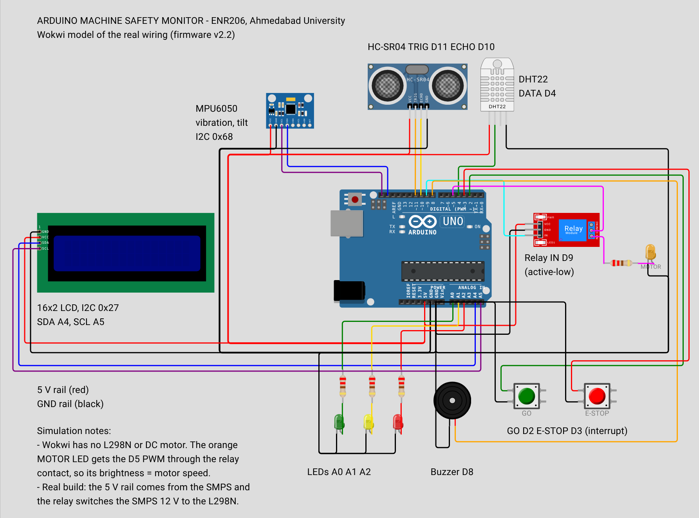
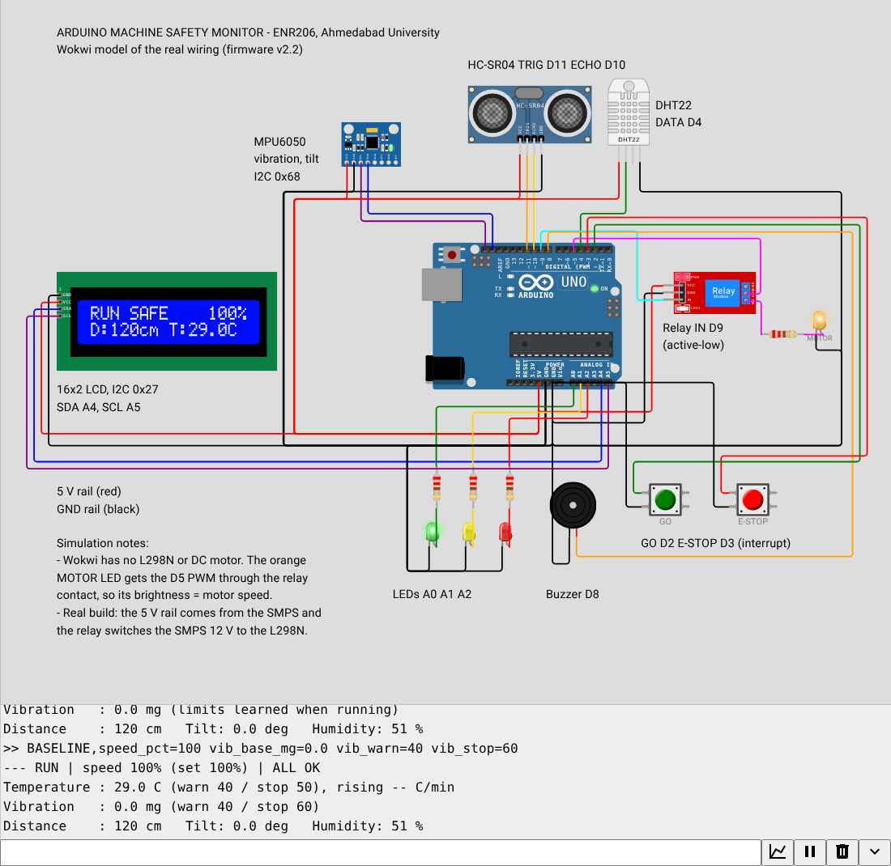

# Wokwi simulation

The real firmware v2.2, unchanged except for one setting, running on a simulated Arduino Uno with the same pin map
as the machine.

**Open it:** [wokwi.com/projects/480655257715515393](https://wokwi.com/projects/480655257715515393), then press the
green play button. No account is needed to run it.

*After GO: the LCD reads "RUN SAFE 100%", the relay and green LED are on, the orange MOTOR LED is lit, and the Serial
Monitor shows the RUN report and the learned vibration baseline.*

## Files

| File | What it is |
| --- | --- |
| [`diagram.json`](diagram.json) | Parts, positions, labels and wires of the circuit |
| [`sketch.ino`](sketch.ino) | All firmware files joined into one sketch (Wokwi takes a single file). Generated: do not edit |
| [`make_sketch.py`](make_sketch.py) | Rebuilds `sketch.ino` from `firmware/MachineSafetyMonitor` |
| [`libraries.txt`](libraries.txt) | Libraries Wokwi installs: LiquidCrystal I2C, DHT sensor library, Adafruit Unified Sensor |

To change the simulation, edit the firmware, run `python3 hardware/wokwi/make_sketch.py`, and paste the new
`sketch.ino` (and `diagram.json` if the circuit changed) into a copy of the Wokwi project.

## How it differs from the machine

| Machine | Wokwi |
| --- | --- |
| L298N driver and 12 V geared motor | Wokwi has neither. The D5 PWM goes through the relay contact to an orange LED, so its brightness follows the motor speed |
| SMPS 5 V output feeds the sensor rail | The Uno's 5V pin feeds it |
| MPU6050 with real noise | Wokwi's MPU6050 gives perfectly steady numbers. `make_sketch.py` sets `WOKWI_SIMULATION 1`, which only skips the frozen-sensor check |

Click a sensor while the simulation runs to change its value: the distance of the HC-SR04, the temperature and
humidity of the DHT22, or the acceleration of the MPU6050.
